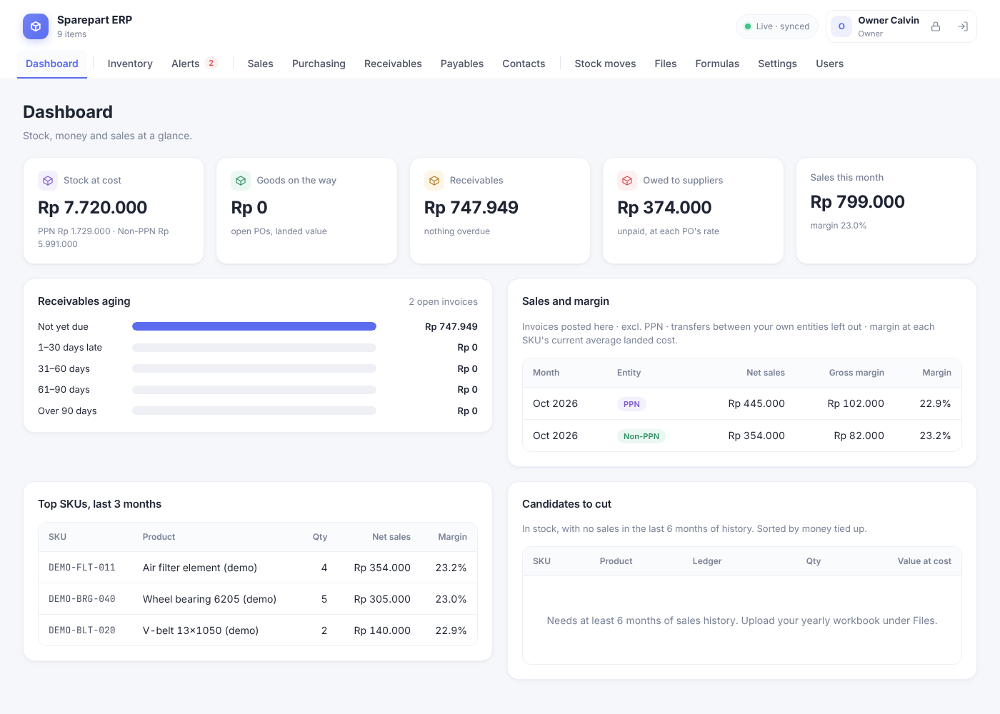
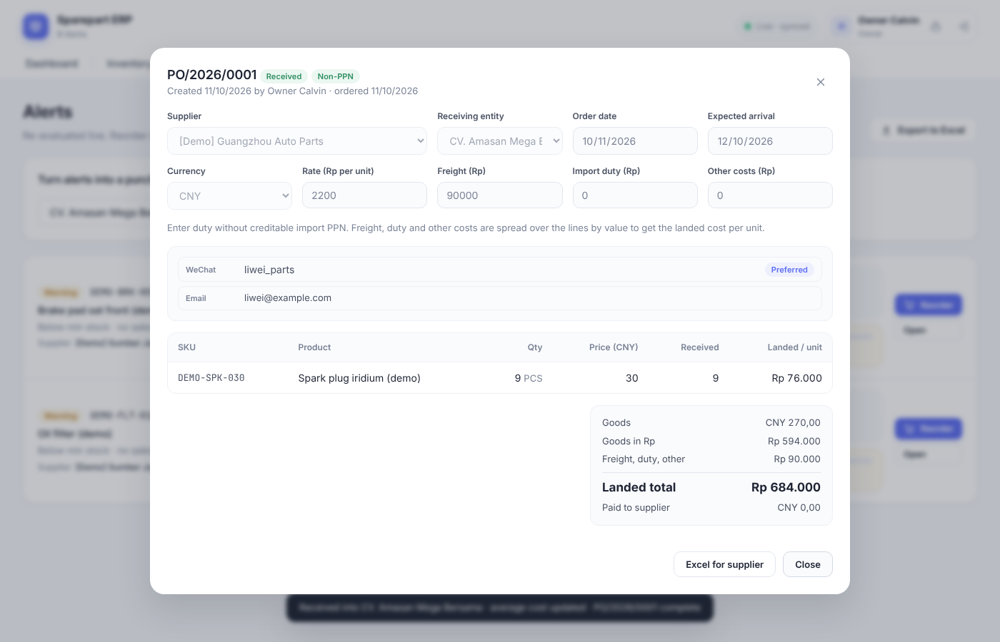
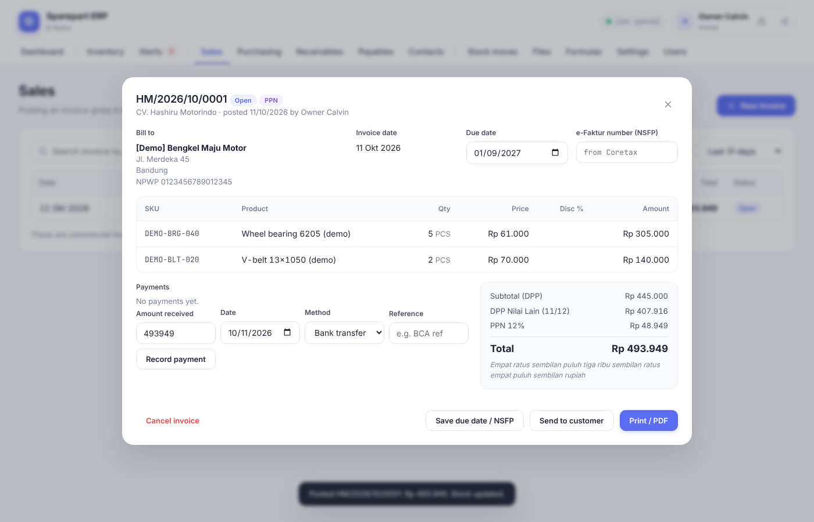

# Sparepart ERP

Spare-part ERP for two entities: **CV. Hashiru Motorindo** (PPN) and **CV. Amasan Mega Bersama** (Non-PPN). It is a standalone rebuild of the *Sparepart ERP* Claude artifact (the original stock-ledger artifact is kept in `legacy/`), with its own server and database and a softer, white-first design.







## Features

Pages are grouped like the artifact: **Dashboard** | Inventory, Alerts | Sales, Purchasing, Receivables, Payables, Expenses, Employees, Contacts | Stock moves, Files, Formulas, Settings, Users.

| Area | What it does |
|---|---|
| **Dashboard** (owner) | Stock at cost per entity, goods on the way, receivables with aging buckets, what you owe suppliers, sales, gross margin, expenses and **operating profit** by month and entity, top SKUs, and **candidates to cut** (in stock, no sales in 6 months, sorted by money tied up). |
| **Inventory** | Products by SKU and entity, unit (PCS / SET), on hand, **on order**, sell price, price incl. PPN, **average landed cost**, margin, value at cost, min stock, **MOQ** and **order multiple**, supplier. Costs are visible to the owner only. |
| **Alerts** | Live list driven by alert formulas, comparing **stock on hand + on order** against the reorder point (or min stock without sales history). **Turn alerts into a purchase order**: pick the entity and a supplier (or "any supplier": one draft PO per supplier). Suggested quantities are rounded up to MOQ and order multiple. |
| **Purchasing** (owner) | `PO/2026/0001`. Draft → **Ordered** → **Part received** → **Received** (or *Closed short* / *Cancelled*). Each PO has a receiving entity, order date, expected arrival, **currency (IDR / CNY / USD) and rate**, freight, import duty and other costs. Receiving books stock in at **landed cost** (price × rate + charges spread by value) and updates the product's **moving-average cost**. Send the order by WhatsApp / email / WeChat / phone, or download it as Excel for the supplier. |
| **Payables** (owner) | What you owe each supplier per PO, in the PO's currency and in rupiah. Record payments with the rate actually paid. Cancelled or closed orders only owe what arrived. |
| **Sales** | Invoices per entity, numbered `HM/2026/10/0001` and `AMB/2026/10/0001` (prefixes in Settings). Draft → **Post invoice** (takes stock out; refuses if stock is short) → paid, or **Cancel** (owner, with a reason; stock goes back, the number is not reused). PPN invoices show **PPN 11%** of the price, or, if you switch Settings → "PPN on invoices", the Coretax format DPP Nilai Lain (11/12) × 12%. There's a field for the e-Faktur number (NSFP). When adding a product, its sell price is filled in and can be changed before the line is added. Print / PDF with letterhead and terbilang; send by WhatsApp or email. |
| **Internal transfers** | Mark a contact as one of your own entities. A posted invoice to it moves the stock into the other entity at the net price (updating its average cost) and stays out of sales, demand and receivables. |
| **Receivables** (owner) | Open invoices oldest first, overdue days, totals per customer, recent payments; record payments (transfer, cash, giro, offset). |
| **Expenses** (owner) | Running costs per entity with date, category, description and how they were paid. Mark rent, internet and the like as **monthly** and copy them into the next month in one click. Each month shows totals by category and entity, and a **monthly history** compares every month with the one before. Paid salaries are included automatically; typing "Salaries" as an expense is refused so nothing is counted twice. |
| **Employees & payroll** (owner) | Employee list with position, employing entity, phone, bank account, start date, base salary and fixed allowance; switch people to inactive instead of deleting them. **Payroll** per month: pay one person with a bonus or deductions, or pay everyone still unpaid at their standard salary. One payment per person per month; amounts are copied in, so a later raise doesn't rewrite history. |
| **Contacts** | Customers and suppliers on one page. Suppliers: currency, terms, WhatsApp / WeChat / email / phone, NPWP, address. Customers: terms, NPWP, address, internal flag. |
| **Users & roles** | Sign-in required. **Admin = owner**: everything, including costs, purchasing, money pages and the dashboard. **Staff**: inventory, alerts, sales invoices, contacts, stock moves, files; no costs. **Viewer**: read only. |
| **Formulas** | Small expression language (no `eval`) for alert rules and computed columns, with live "would trigger on N items" testing. Variables include `position`, `cost`, `margin_pct`, `moq`, `lot`. |
| **Files & reports** | Upload any file (≤ 15 MB). Hashiru sales reports, stock reports and yearly workbooks are parsed, reconciled to the report totals, and feed demand history. |
| **Safety stock** | `Z × σ(monthly sales) × √((lead time + check interval) ÷ 30.4)`, plus reorder point, order-up-to and suggested order. Months blocked by a stock-out are left out. |
| **Import / export / backup** | Import products from Excel/CSV (`Harga Jual` = sell price, `Harga Beli` / `HPP` = cost, `MOQ`; missing columns keep their values). Export stock or alerts. **Full backup to Excel**: products, contacts, invoices, receivables, purchase orders with landed cost, both payment ledgers and all stock moves. |
| **Live sync** | Every open browser updates when anyone saves (Server-Sent Events). |

## Running it

Requires **Node.js 22.5 or newer** (uses the built-in `node:sqlite`, so there is nothing to compile).

```bash
npm install
npm run seed:demo    # optional: 8 DEMO- products, 2 [Demo] suppliers (IDR and CNY) and a [Demo] customer
npm start            # http://127.0.0.1:3000
npm test             # unit + API tests
```

**First run:** the terminal prints a one-time **setup code**. Open the app, enter the code and create your admin account. Then add your staff under **Users**. The code is only accepted until the first admin exists, so nobody else on the network can claim the account first.

**Forgot the admin password?** On the server: `npm run reset-password -- <username>` prints a new temporary password.

| Variable | Default | Meaning |
|---|---|---|
| `PORT` | `3000` | HTTP port |
| `HOST` | `127.0.0.1` | Set `0.0.0.0` to let other computers on your network use it — **read "Security" first** |
| `COOKIE_SECURE` | off | Set `1` when the app is served over HTTPS, so the sign-in cookie is never sent unencrypted |
| `TRUST_PROXY` | off | Set `1` behind a reverse proxy (nginx, Caddy) so login rate-limiting sees real client IPs |
| `DATA_DIR` | `./data` | SQLite database (`erp.sqlite`) and uploaded files (`uploads/`) |

**Back up `DATA_DIR`.** It holds everything: the database and every uploaded file. The Excel backup under Settings is a readable copy of the records, not a restore file.

## Moving your data from the artifact

Only the code came over; your products, formulas and reports are still in the artifact's own storage.

1. In the artifact, **Import & settings → Export all to Excel**.
2. Here, **Import & settings → Import products** with that file. (The export's `Ledger` column is read as the tax column.)
3. Re-create any custom formulas on the **Formulas** page.
4. Re-upload your sales and stock reports on **Files & reports** to rebuild demand history.

## Project layout

```
server/        Express API + SQLite (app.js routes, db.js schema, sales.js, purchasing.js, auth.js)
public/        Browser app, no build step
  js/formula.js  formula parser/evaluator      (pure, tested)
  js/stock.js    demand stats, safety stock    (pure, tested)
  js/reports.js  Hashiru report readers        (pure, tested)
  js/invoice.js  invoice totals, PPN, terbilang (pure, tested)
  js/app.js      UI
scripts/       seed-demo.js
test/          node:test suites
legacy/        the original single-file artifact
```

## Security and known limits

- **Sign-in.** Passwords are hashed with scrypt; sessions are random tokens in an HttpOnly, SameSite=Strict cookie (only their hash is stored); 5 wrong passwords lock that username for 15 minutes from that address; writes need a header other websites can't send (CSRF protection). Switching a user off, changing their role or resetting their password signs them out everywhere at once.
- **Use HTTPS before opening it to a network.** Over plain HTTP, passwords and cookies cross the network unencrypted. Put it behind Caddy or nginx with a certificate and set `COOKIE_SECURE=1` and `TRUST_PROXY=1`. Localhost-only use (the default) doesn't need this.
- **SheetJS** is installed from SheetJS's own CDN (0.20.3), because the npm registry only has 0.18.5, which has known advisories. `npm install` therefore needs access to `cdn.sheetjs.com`.
- **Phone numbers** starting with 0 are assumed Indonesian (+62) for WhatsApp links; enter foreign numbers with + and the country code.
- **Order prices** default to the last price paid in that currency (or the average cost for rupiah orders) and can be edited until the goods arrive. The rate, freight and duty can be corrected before receiving; the landed cost is fixed at the moment of receipt.
- **Average cost** is a moving average of landed cost. Stock that was zero or negative when goods arrive takes the new landed cost as is.
- **Invoices are not submitted to DJP.** Issue the official e-Faktur in Coretax yourself and paste its number (NSFP) on the invoice. Invoices show PPN 11% of the price by default. Coretax computes 12% × DPP Nilai Lain (11/12); it's the same tax, but rounding can make the two differ by Rp 1 (Rp 1,000,000 → Rp 110,000 vs Rp 109,999). If your invoice totals must match the e-Faktur to the rupiah, switch "PPN on invoices" to the Coretax format. Invoices already posted keep their amounts.
- **Sales history:** issued invoices feed the safety-stock model for complete months that have no uploaded Hashiru sales report. Where a month has both, the report is used, so nothing is counted twice.
- **Payroll does not calculate BPJS or PPh 21.** Enter them as deductions; your accountant or payroll provider remains the source for those amounts and the tax filings. Expenses are recorded when paid (cash basis), not when the bill arrives.
- **Not yet built:** sales returns / credit notes (today: cancel and re-post), multiple warehouses, a full audit log of every change, and a printable PDF purchase order (Excel and message only).
