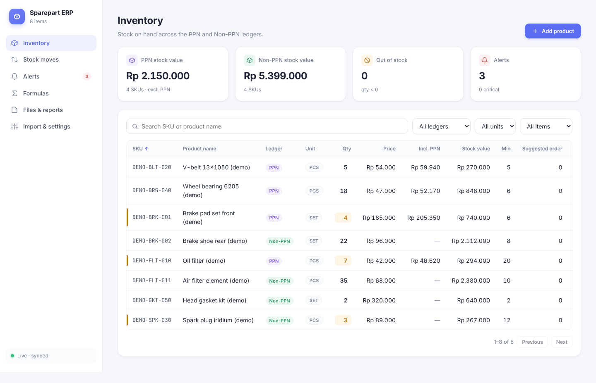

# Sparepart ERP

Spare-part inventory system with separate **PPN** and **Non-PPN** ledgers. It is a standalone rebuild of the *Sparepart Stock Ledger* Claude artifact (the original is kept in `legacy/`), with its own server and database and a softer, white-first design.



## Features

| Area | What it does |
|---|---|
| **Inventory** | Products by SKU and ledger, unit (PCS / SET), qty, price, min stock. Search, filters, sortable columns, paging, stock-value KPIs. |
| **Stock moves** | Book IN / OUT / ADJ. Stock is updated on the server in one transaction, so two people booking at once can't overwrite each other. OUT below zero is refused. |
| **Alerts** | Live list driven by alert formulas, with a gauge showing stock vs safety stock, reorder point and min stock. Export to Excel. |
| **Formulas** | Small expression language (no `eval`) for alert rules and computed columns, with live "would trigger on N items" testing. |
| **Files & reports** | Upload any file (≤ 15 MB). Hashiru sales reports, stock reports and yearly workbooks are parsed, reconciled to the report totals, and feed demand history. A coverage grid shows which months are loaded. |
| **Safety stock** | `Z × σ(monthly sales) × √((lead time + check interval) ÷ 30.4)`, plus reorder point, order-up-to and suggested order. Months blocked by a stock-out are left out. |
| **Import / export** | Import products from Excel/CSV (Indonesian number formats understood); export inventory or alerts to Excel. |
| **Live sync** | Every open browser updates when anyone saves (Server-Sent Events). |

New databases start with four formulas: *Below safety stock*, *Reorder now*, *Below min stock* and a *Suggested order* column.

## Running it

Requires **Node.js 22.5 or newer** (uses the built-in `node:sqlite`, so there is nothing to compile).

```bash
npm install
npm start            # http://127.0.0.1:3000
npm run seed:demo    # optional: 8 DEMO- products to try things out
npm test             # unit + API tests
```

| Variable | Default | Meaning |
|---|---|---|
| `PORT` | `3000` | HTTP port |
| `HOST` | `127.0.0.1` | Set `0.0.0.0` to let other computers on your network use it — **read "Security" first** |
| `DATA_DIR` | `./data` | SQLite database (`erp.sqlite`) and uploaded files (`uploads/`) |

**Back up `DATA_DIR`.** It holds everything: the database and every uploaded file.

## Moving your data from the artifact

Only the code came over; your products, formulas and reports are still in the artifact's own storage.

1. In the artifact, **Import & settings → Export all to Excel**.
2. Here, **Import & settings → Import products** with that file. (The export's `Ledger` column is read as the tax column.)
3. Re-create any custom formulas on the **Formulas** page.
4. Re-upload your sales and stock reports on **Files & reports** to rebuild demand history.

## Project layout

```
server/        Express API + SQLite (app.js routes, db.js schema, reports.js report storage)
public/        Browser app, no build step
  js/formula.js  formula parser/evaluator      (pure, tested)
  js/stock.js    demand stats, safety stock    (pure, tested)
  js/reports.js  Hashiru report readers        (pure, tested)
  js/app.js      UI
scripts/       seed-demo.js
test/          node:test suites
legacy/        the original single-file artifact
```

## Security and known limits

- **No login yet.** Anyone who can reach the server can read and change everything. That's why it listens on localhost only by default. Add authentication (and HTTPS via a reverse proxy) before opening it to a network.
- **SheetJS 0.18.5** has published advisories (prototype pollution, ReDoS) when reading crafted spreadsheets; the npm registry has no fixed release. It runs in the browser on files your own staff upload, so the risk is low, but the fix is to install 0.20.3+ from SheetJS's own CDN: `npm install https://cdn.sheetjs.com/xlsx-0.20.3/xlsx-0.20.3.tgz`.
- **It is an inventory module, not yet a full ERP.** Purchasing (POs, suppliers), sales orders/invoicing, multi-warehouse, users/roles and an audit log are the natural next modules.
